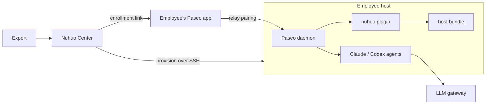

# Nuhuo enterprise plugin design

Status: proposed, version 3, 19 November 2026. Phase 1 is implemented in
[`nuhuo-plugin/`](../nuhuo-plugin/); phase 2 is not started.

Source baseline: Paseo `02124454b`; Nuhuo `9b9addf`. Proposed types and APIs below are contracts
unless this doc names the file that implements them.

## 1. Outcome

Experts maintain Hosts, Skills, Roles, and Workers in Nuhuo. Nuhuo gives each employee one Paseo
host. The employee pairs their Paseo app with that host from an enrollment link and chats with
agents that run as the Workers assigned to them. Employees install nothing besides Paseo.

| Decision                                                                                    | Source                                                 |
| ------------------------------------------------------------------------------------------- | ------------------------------------------------------ |
| One host per employee: a container, VM, or OS user running its own Paseo daemon             | User, 19 Nov 2026                                      |
| Employees enroll through an admin-issued link; company SSO comes later                      | User, 19 Nov 2026                                      |
| Phase 1 uses only today's plugin API; core changes are phase 2                              | User, 19 Nov 2026                                      |
| Nuhuo pushes a host bundle; the plugin never calls Nuhuo to decide whether an agent may run | Proposal                                               |
| Agents follow their Worker's current release on every open                                  | Proposal; see [§6.3](#63-releases-and-existing-agents) |

Version 2 of this doc assumed one operator importing Hosts and Providers from a local Nuhuo Center.
That model is replaced. The Nuhuo half lives in [Nuhuo's integration design](../../nuhuo/docs/paseo-integration-design.md);
its release, variant, and mode-ID rules still apply.

## 2. What Paseo enforces today

| Fact                                                                      | Source                                                      | Consequence                                                                                          |
| ------------------------------------------------------------------------- | ----------------------------------------------------------- | ---------------------------------------------------------------------------------------------------- |
| Every authenticated client is admitted as `owner` with all permissions    | `packages/server/src/server/session-admission-auth.ts:18`   | The employee can change providers, edit plugin settings, and disable or remove plugins on their host |
| Only Hub relationships carry narrower grants                              | `packages/server/src/server/hub/relationship-controller.ts` | Principals and pairing invitations in [permissions](permissions.md) are a model, not code            |
| Agents and terminals run code as the daemon's OS user                     | [permissions](permissions.md#permissions)                   | Anyone who can chat can read what that user can read, including plugin files and credentials         |
| A relay pairing offer is a reusable bearer credential                     | [security](../public-docs/security.md)                      | Phase 1 has no per-device revocation                                                                 |
| `agent.create.before` waits and may rewrite or reject the saved config    | [hooks](../public-docs/plugins/hooks.md#agentcreatebefore)  | The plugin can make every new agent a Worker                                                         |
| `agent.open.before` waits on create, resume, refresh, and import          | [hooks](../public-docs/plugins/hooks.md#agentopenbefore)    | Role, MCP, and environment are re-applied on every open                                              |
| Model, mode, and thinking changes on a running agent have no waiting hook | [hooks](../public-docs/plugins/hooks.md#hooks)              | The plugin cannot veto a live change to bypass mode                                                  |

## 3. Governance boundaries

Because the employee controls their host, put every rule that must hold outside the host. The plugin
sets defaults and makes the Worker experience the normal path; it is not a security boundary.

| Control                                                             | Enforced by                                          | Holds if the employee tampers with the host |
| ------------------------------------------------------------------- | ---------------------------------------------------- | ------------------------------------------- |
| Allowed models, spend, prompt and response audit                    | LLM gateway with a per-employee credential           | Yes                                         |
| Repositories, secrets, and MCP credentials present on the host      | Nuhuo provisioning                                   | Yes                                         |
| Network egress                                                      | Host network policy                                  | Yes                                         |
| Access to the host                                                  | Nuhuo stops or reprovisions it                       | Yes                                         |
| Role, Skills, MCP, provider, model, and starting mode of each agent | Plugin hooks                                         | No                                          |
| Usage records                                                       | LLM gateway logs; the phase 1 plugin reports nothing | Yes                                         |

Never label plugin-applied settings as enforced in the UI. Show them as the Worker's configuration.

## 4. Topology



Nuhuo reaches hosts; hosts never need to reach Nuhuo. The employee's device talks only to their
host, through the relay.

## 5. Lifecycle

### 5.1 Assign

An expert publishes Worker releases in Nuhuo and assigns an employee to a host with a list of
Workers and an optional default Worker. Releases carry a `paseo` runtime variant whose provider,
mode, and thinking IDs come from the target daemon, as [Nuhuo §5.3](../../nuhuo/docs/paseo-integration-design.md#53-mode-and-thinking-ids)
requires.

### 5.2 Provision

Nuhuo prepares the host in this order and stops at the first failure:

1. Create the isolated environment and a dedicated OS user. Mount only the employee's repositories.
2. Install Paseo and start the daemon with `paseo daemon start`. Keep it on loopback; the relay is the
   only route in.
3. Write provider credentials for the LLM gateway into the daemon's environment or provider config.
   Use a per-employee key, never a shared one.
4. Deploy Skills to the providers' native skill directories with Nuhuo's existing sync.
5. Write MCP secrets to the secrets directory ([§6.2](#62-secrets)) and the host bundle ([§6](#6-host-bundle)).
6. Install the plugin with `paseo plugin add <path>`, set `pluginsEnabled` to `true`, and run
   `paseo reload`. Installed plugins stay off until that switch is on.
7. Run `paseo daemon pair --relay --json` and keep the offer URL for enrollment.

### 5.3 Enroll

Nuhuo shows the employee a one-time enrollment page with the offer as a link and QR code. The
employee opens it in the Paseo app on desktop, phone, or browser. Treat the page like a password:
expire it after first view and log who opened it.

### 5.4 Chat

The new-agent composer shows a **Worker** picker. Choosing a Worker sets the provider, model, mode,
and thinking the release names. On creation the plugin applies the release again and records the
binding, so an agent created through the CLI, SDK, or another agent gets the same configuration.

### 5.5 Update and offboard

Nuhuo updates the bundle by rewriting the file. New agents use the new release at once; existing
agents pick it up on their next open ([§6.3](#63-releases-and-existing-agents)). Removing a Worker
from the bundle stops its agents from opening. To offboard an employee, stop the host. A new offer
requires reprovisioning, because phase 1 cannot revoke a paired device.

## 6. Host bundle

The bundle is the only contract between Nuhuo and the plugin. Nuhuo writes it atomically (write a
temporary file in the same directory, then rename) to `~/.nuhuo/paseo/host-bundle.json`, or to the
path in the daemon's `NUHUO_PASEO_BUNDLE` environment variable. The plugin process inherits the
daemon's environment. Schema: `nuhuo-plugin/shared/bundle.ts`.

```ts
type HostBundle = {
  schema: 1;
  centerId: string;
  hostId: string;
  employee: { id: string; displayName: string };
  issuedAt: string;
  expiresAt?: string;
  requireWorker: boolean;
  defaultWorkerId?: string;
  workers: WorkerRelease[];
};

type WorkerRelease = {
  workerId: string;
  name: string;
  description?: string;
  releaseDigest: string;
  displayVersion: string;
  provider: string; // Paseo provider ID
  model?: string;
  modeId?: string; // Paseo mode ID
  thinkingOptionId?: string;
  allowedOverrides: ("model" | "modeId" | "thinkingOptionId")[];
  instructions: string; // ROLE.md, profile instructions, and the Skill index with host paths
  mcpServers: Record<string, McpServerTemplate>; // secrets as { secretRef }
  env: Record<string, string>;
  secretEnv: Record<string, { secretRef: string }>;
};
```

The plugin reads the bundle on every create, open, and status request, so a rewrite applies at once.
A missing, invalid, or expired bundle blocks new agents and interactive opens with a message naming
the problem. History opens always proceed.

### 6.1 Applying a release

On `agent.create.before`:

| Request                                                 | Result                    |
| ------------------------------------------------------- | ------------------------- |
| `metadata["nuhuo.worker"]` names a Worker in the bundle | Apply that release        |
| No Worker, `defaultWorkerId` set                        | Apply the default release |
| No Worker, no default, `requireWorker: true`            | Reject: choose a Worker   |
| No Worker, `requireWorker: false`                       | Leave the agent ordinary  |
| Worker not in the bundle                                | Reject, naming the Worker |

Applying sets `provider` from the release. Provider changes reset the rest, so the release's model,
mode, and thinking replace the request's. On the same provider, a field listed in `allowedOverrides`
keeps the request's value and other fields take the release's. The plugin writes
`metadata["nuhuo.binding"] = { centerId, workerId, workerName, releaseDigest }` and drops any binding
the caller sent. It does not save the Role into `systemPrompt`.

On `agent.open.before` with `purpose: "interactive"`:

| Agent                                      | Result                                                               |
| ------------------------------------------ | -------------------------------------------------------------------- |
| Bound, Worker in the bundle, same provider | Append `instructions`; add `mcpServers`, `env`, and resolved secrets |
| Bound, Worker removed from the bundle      | Block: the Worker is no longer assigned                              |
| Bound, release moved to another provider   | Block: start a new agent for this Worker                             |
| Unbound, `requireWorker: true`             | Block: covers imports and agents created before the plugin           |
| Unbound, `requireWorker: false`            | No change                                                            |

### 6.2 Secrets

`secretRef` names a file in `~/.nuhuo/paseo/secrets/`. Nuhuo writes the directory with mode `0700`
and files with `0600`. The plugin reads them at open time, so secrets never enter the agent's saved
configuration or the bundle. A name containing a path separator or a missing file blocks the open.

### 6.3 Releases and existing agents

Launch-only contributions are re-derived on every open, so an existing agent follows its Worker's
current release: a fixed Role or Skill reaches every employee without restarting conversations. The
saved provider, model, mode, and thinking stay as created. The binding's `releaseDigest` records what
the agent was created with, for audit. Pinning each agent to its creation release needs the
immutable binding of phase 2.

## 7. Plugin (phase 1)

Package: `nuhuo-plugin/` at the repository root, manifest ID `nuhuo`. It runs on the employee's host
only. Keep it out of `plugins/`: built-ins load for every Paseo user, everything in that directory
ships in the desktop build, and built-in IDs cannot be installed by path. It is not an npm workspace,
so root `npm run typecheck` skips it; run `npm install --legacy-peer-deps`, `npm run typecheck`, and
`npm test` inside it.

The plugin requires the first Paseo release after 0.16.2. `appendSystemPrompt` on
`agent.open.before` landed in paseo#9781 and is in no 0.16.x release, so the manifest declares
`>=0.17.0-0`. Correct the range if that change ships under another version.

| File                       | Responsibility                                    |
| -------------------------- | ------------------------------------------------- |
| `shared/bundle.ts`         | Zod schema for the host bundle and binding        |
| `shared/rpc.ts`            | `nuhuo.status.get` contract                       |
| `server/bundle-store.ts`   | Locate, read, and validate the bundle             |
| `server/policy.ts`         | Decision tables in [§6.1](#61-applying-a-release) |
| `server/secrets.ts`        | Resolve `secretRef` files                         |
| `client/worker-picker.tsx` | Composer item: Worker `Select`                    |
| `client/status-screen.tsx` | Settings screen: bundle state, employee, Workers  |

The composer item reads Workers through `nuhuo.status.get`. In a draft it sets
`metadata["nuhuo.worker"]` and then the release's provider, model, mode, and thinking, so the composer
shows what will run. On a running agent it shows the bound Worker and is disabled. The create hook
remains the authority; the picker only shows the choice before submit.

Errors name the Worker and the fix, for example **Worker "Code reviewer" is no longer assigned to
this host. Start a new agent with another Worker.** Raw schema errors go to the plugin log.

## 8. Phase 1 limits

- The employee is `owner` of their host. They can disable the plugin, edit the bundle or its
  settings, or change an agent's metadata. [§3](#3-governance-boundaries) lists what still holds.
- A running agent's model, mode, and thinking can change without a check.
- Withdrawal reaches a running agent at its next open; turns on an open agent continue.
- A paired device cannot be revoked without reprovisioning the host.
- Agent MCP tools such as `create_agent` cannot choose a Worker; children get the default Worker.

## 9. Phase 2: core changes

| Item                                 | Change                                                                                                                                                                     | Unlocks                                                                              |
| ------------------------------------ | -------------------------------------------------------------------------------------------------------------------------------------------------------------------------- | ------------------------------------------------------------------------------------ |
| C1 Principals and invitations        | Implement the [permissions](permissions.md) model for direct and relay clients: single-use pairing invitations that create a principal with chosen grants, plus revocation | Employees get `workspace.*` only; Nuhuo keeps `daemon.manage`; per-device revocation |
| C2 Runtime-change and turn admission | Awaited plugin callbacks before model/mode/thinking/option changes and before each turn                                                                                    | Policy holds for live changes and withdrawal stops the next turn                     |
| C3 Launch binding                    | Store the Worker binding outside metadata; only the creation path writes it; resume requires the binding's source                                                          | Pinned releases; metadata cannot forge or remove a binding                           |
| C4 Worker-aware agent tools          | `list_agent_launches`, `plan_agent_launch`, `create_agent_from_launch` on the existing creation path                                                                       | Orchestrator agents delegate to named Workers                                        |
| C5 Shared hosts                      | Workspace-scoped grants with resource checks on every operation, and per-user OS isolation for agents and terminals                                                        | Several employees on one daemon                                                      |

C1 alone does not make governance hold: a `workspace.write` principal can still run code as the
daemon user through an agent. Pair it with an agent runtime that cannot read daemon state, such as a
separate OS user for agent processes.

Follow [protocol compatibility](protocol-compatibility.md) and [RPC namespacing](rpc-namespacing.md):
advertise each item under `server_info.features`, add dotted `.request`/`.response` RPCs, and keep new
fields optional. The plugin checks the features once and keeps phase 1 behavior on older hosts.

## 10. Nuhuo dependencies

| Item                                                                                                                                                               | Status                |
| ------------------------------------------------------------------------------------------------------------------------------------------------------------------ | --------------------- |
| Authenticate the service before exposing it beyond loopback ([Nuhuo §3](../../nuhuo/docs/paseo-integration-design.md#3-prerequisite-authenticate-the-service-n00)) | Blocking              |
| Employee records and assignment of employee → host → Workers                                                                                                       | New                   |
| Releases with a verified `paseo` variant                                                                                                                           | Specified in Nuhuo §5 |
| Provisioning a Paseo host ([§5.2](#52-provision)) and rewriting its bundle                                                                                         | New                   |
| One-time enrollment page                                                                                                                                           | New                   |

## 11. Verification

| Case                                | Expected                                                                                   |
| ----------------------------------- | ------------------------------------------------------------------------------------------ |
| Create with a chosen Worker         | Saved provider/model/mode/thinking match the release; binding metadata written             |
| Create without a Worker             | Default applied, rejected, or ordinary according to [§6.1](#61-applying-a-release)         |
| Overrides                           | Allowed field keeps the caller's value; other fields take the release's                    |
| Open                                | Role appended, MCP and env added, secrets resolved from files and absent from saved config |
| Worker removed or provider changed  | Interactive open blocked with the Worker named; history open works                         |
| Bundle missing, invalid, or expired | New agents and interactive opens blocked; a rewrite applies on the next request            |
| Unbound agent with `requireWorker`  | Interactive open blocked                                                                   |
| Picker                              | Draft, New workspace, and running-agent composers on iOS, Android, browser, and Electron   |

`nuhuo-plugin/server/policy.test.ts` covers the decision tables, bundle states, and secret
files. Hook wiring and the picker need an [ad-hoc daemon](ad-hoc-daemon-testing.md) run on a build
that includes paseo#9781.
