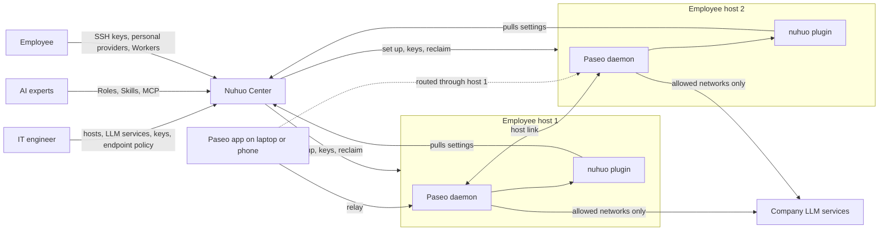

# Nuhuo enterprise plugin design

Status: version 7, 20 November 2026. [`nuhuo-plugin/`](../nuhuo-plugin/) implements version 6
against Nuhuo's host API; [§7.1](#71-version-7-changes) lists what version 7 adds to it, and
[§10](#10-nuhuo-dependencies) what Nuhuo still lacks. Phase 2 is not started.

Source baseline: Paseo `02124454b` with plugin SDK `0.17.0-beta.1`; Nuhuo `676adcc` on
`paseo-catalog-peers`, which adds peer hosts and Workers to `main` at `cd0b393`.

## 1. Outcome

IT keeps the company's hosts in Nuhuo's [host inventory](../../nuhuo/docs/host-inventory-design.md) and allocates them to
employees by count. Nuhuo creates the employee's account on each host, installs their SSH public keys,
and sets up Paseo with the Nuhuo plugin. The employee sees their hosts in Nuhuo and configures
everything else there:

- Providers. IT assigns each employee a key for each of the company's own LLM services; these
  enterprise providers reach all of the employee's hosts. The employee adds personal providers with
  their own keys and picks the hosts that get each one. Every provider's base URL must be on a
  network IT allows.
- Workers, each picking one of their hosts, a Role, a provider on that host, a model, a mode, a
  thinking level, and a working directory.

The plugin on each host imports all of it, so every agent is ready to use in Paseo. The employee
chats from the Paseo app on their laptop, phone, or browser, and the agents keep running while the
laptop is closed. A Worker agent can start any of the employee's other Workers as a subagent on that
Worker's host. AI experts maintain the Roles, Skills, and MCP server templates Workers use.

The Paseo app on the employee's laptop also runs a local daemon, where the employee sets up their own
agents and providers. That daemon is out of scope: the plugin never runs there.

| Decision                                                                                                                         | Source                                                                                              |
| -------------------------------------------------------------------------------------------------------------------------------- | --------------------------------------------------------------------------------------------------- |
| IT allocates hosts from Nuhuo's inventory by employee and count; an employee can have many; a host has one owner                 | User, 19 Nov 2026                                                                                   |
| Nuhuo installs the employee's SSH public key and sets each allocated host up; nobody configures one by hand                      | User, 19 Nov 2026                                                                                   |
| The employee sees all their hosts in Nuhuo                                                                                       | User, 19 Nov 2026                                                                                   |
| Providers created in Nuhuo are ready to use in Paseo                                                                             | User, 19 Nov 2026                                                                                   |
| IT assigns keys for the company's own LLM services to employees, and they are set up on the employee's hosts                     | User, 20 Nov 2026                                                                                   |
| Employees can switch an enterprise provider off but cannot change its key or base URL, in Nuhuo or in Paseo                      | User, 20 Nov 2026                                                                                   |
| A provider's base URL may reach only the local network, or only the local networks IT allows                                     | User, 20 Nov 2026                                                                                   |
| A personal key stays bound to its owner, who chooses the hosts that get it; sharing comes later                                  | User, 20 Nov 2026                                                                                   |
| Employees create their own Workers in Nuhuo                                                                                      | User, 19 Nov 2026                                                                                   |
| The plugin imports the employee's settings from Nuhuo; the employee chats in Paseo                                               | User, 19 Nov 2026                                                                                   |
| Workers run as subagents of other Workers, across the employee's hosts                                                           | User, 19 Nov 2026                                                                                   |
| Employees enroll their devices through a link; company SSO comes later                                                           | User, 19 Nov 2026                                                                                   |
| Phase 1 uses only today's plugin API; core changes are phase 2                                                                   | User, 19 Nov 2026                                                                                   |
| Nuhuo manages hosts with IT's credential for each source; the employee's account has no sudo unless IT grants it                 | Proposal; see [host inventory](../../nuhuo/docs/host-inventory-design.md#4-sources-and-credentials) |
| Nuhuo reaches a host directly only to set it up, repair it, sync keys, and reclaim it; settings arrive through the plugin's pull | Proposal; see [§4](#4-topology)                                                                     |
| The plugin runs on every employee host and nowhere else                                                                          | Proposal; see [§4](#4-topology)                                                                     |
| Each host links to the employee's other hosts, so one enrollment shows all of them                                               | Proposal; see [§5.5](#55-enroll)                                                                    |
| Create and open decide from the host's cached catalog, so a Nuhuo outage stops no running work                                   | Proposal; see [§6.2](#62-catalog)                                                                   |
| Agents follow their Worker's current release on every open                                                                       | Proposal; see [§6.6](#66-releases-and-existing-agents)                                              |
| The plugin sets each Nuhuo provider's key and base URL at every launch, so an edited profile changes nothing an agent sends      | Proposal; see [§6.7](#67-providers)                                                                 |
| IT's network egress policy is the hard limit on endpoints; base URL checks make the rule visible and catch mistakes              | Proposal; see [§3](#3-governance-boundaries)                                                        |

Versions 3 to 5 had Nuhuo prepare one host per employee, IT configure hosts, or the employee link
each host. Version 6 had every provider carry the employee's own key to all their hosts. All are
replaced. Nuhuo's [host inventory design](../../nuhuo/docs/host-inventory-design.md) owns how hosts reach employees. The
rest of the Nuhuo half, from accounts and providers to the host API, lives in
[Nuhuo's integration design](../../nuhuo/docs/paseo-integration-design.md).

## 2. What Paseo provides today

| Fact                                                                                        | Source                                                           | Consequence                                                                                           |
| ------------------------------------------------------------------------------------------- | ---------------------------------------------------------------- | ----------------------------------------------------------------------------------------------------- |
| Every authenticated client is admitted as `owner` with all permissions                      | `packages/server/src/server/session-admission-auth.ts:18`        | The employee can change providers, edit plugin settings, and disable or remove plugins on their hosts |
| Only Hub relationships carry narrower grants                                                | `packages/server/src/server/hub/relationship-controller.ts`      | Principals and pairing invitations in [permissions](permissions.md) are a model, not code             |
| Agents and terminals run code as the daemon's OS user                                       | [permissions](permissions.md#permissions)                        | Anyone who can chat can read what that user can read, including plugin files and credentials          |
| A relay pairing offer is a reusable bearer credential                                       | [security](../public-docs/security.md)                           | Phase 1 has no per-device revocation                                                                  |
| `config.patch` adds and removes provider profiles, including their `env`, without a restart | `packages/server/src/server/daemon-config-store.ts:387`          | The plugin installs the employee's providers and keys                                                 |
| Provider profiles are ordinary config; none is read-only                                    | `packages/protocol/src/provider-config.ts:51`                    | The employee can edit a `nuhuo-` profile; the plugin restores it at the next pull                     |
| A profile has an `enabled` switch                                                           | `packages/protocol/src/provider-config.ts:64`                    | The employee can switch a Nuhuo provider off on one host                                              |
| The launch `env` from `agent.open.before` overlays the profile's `env`                      | `packages/server/src/server/agent/provider-launch-config.ts:229` | The plugin's key and base URL win over an edited profile                                              |
| Commit messages, PR text, branch names, and titles call a provider outside any agent        | [metadata generation](../public-docs/metadata-generation.md)     | Hooks do not see these calls; the plugin points them at a Nuhuo provider                              |
| `agent.create.before` waits and may rewrite or reject the saved config                      | [hooks](../public-docs/plugins/hooks.md#agentcreatebefore)       | The plugin can make every new agent a Worker                                                          |
| The create hook receives `config`, `env`, and `metadata`, not labels                        | `packages/plugin/src/server/lifecycle.ts:131`                    | Native `create_agent` cannot name a Worker                                                            |
| `agent.open.before` waits on create, resume, refresh, and import                            | [hooks](../public-docs/plugins/hooks.md#agentopenbefore)         | Role, MCP, environment, and tools are re-applied on every open                                        |
| Model, mode, and thinking changes on a running agent have no waiting hook                   | [hooks](../public-docs/plugins/hooks.md#hooks)                   | The plugin cannot veto a live change to bypass mode                                                   |
| A daemon saves other hosts; its agents create and prompt agents there by `serverId`         | [connected hosts](connected-hosts.md#delegating-agents)          | Workers delegate across the employee's hosts                                                          |
| The app adds every host saved on a daemon it connects to, routed through that daemon        | `packages/app/src/runtime/host-runtime.ts:2527`                  | One enrollment shows all of an employee's hosts                                                       |
| A plugin attaches tools to agents at open; a tool runs in the plugin with a Paseo API       | [hooks](../public-docs/plugins/hooks.md#attach-tools-to-agents)  | The plugin gives agents a tool that starts a Worker                                                   |
| SDK creation accepts `metadata` and a `parent` on another host                              | `packages/client/src/index.ts:268`                               | A Worker child is bound at creation and appears in its parent's Subagents track                       |
| Agent-scoped `send_agent_prompt` to another host registers a finish notification            | `packages/server/src/server/agent/tools/paseo-tools.ts:671`      | The parent learns when a Worker child finishes                                                        |
| Paseo has no command that installs the daemon as a boot service                             | [CLI reference](../public-docs/cli.md)                           | Nuhuo's setup writes the service unit itself                                                          |

## 3. Governance boundaries

Because the employee controls the account their daemon runs as, put every rule that must hold
outside it. The plugin sets defaults and makes the Worker experience the normal path; it is not a
security boundary.

| Control                                                             | Enforced by                                                             | Holds if the employee tampers with a host |
| ------------------------------------------------------------------- | ----------------------------------------------------------------------- | ----------------------------------------- |
| Spend and model access of a key                                     | The LLM service or provider account that issued it                      | Yes                                       |
| Which endpoints a host reaches                                      | IT's network egress policy for the host                                 | Yes                                       |
| Access to a host                                                    | IT reclaims it in Nuhuo's inventory, or stops or wipes it               | Yes                                       |
| Which hosts receive a key                                           | Nuhuo's placement; `/secrets` serves only keys placed on the host       | Yes                                       |
| Enterprise key and base URL                                         | Nuhuo's routes; the plugin at every pull and launch                     | In Nuhuo yes; on the host no              |
| Base URLs inside the allowed networks                               | Nuhuo when saving and building catalogs; the plugin at pull and launch  | No                                        |
| Only Nuhuo providers on employee hosts                              | Plugin hooks                                                            | No                                        |
| Provider kinds, Roles, and models offered in Nuhuo                  | Nuhuo's forms                                                           | No                                        |
| Role, Skills, MCP, provider, model, and starting mode of each agent | Plugin hooks                                                            | No                                        |
| Usage records                                                       | The LLM service or provider account; the phase 1 plugin reports nothing | Yes                                       |

Never label plugin-applied settings as enforced in the UI. Show them as the Worker's configuration,
and enterprise providers as **Managed by IT**.

Base URL checks make the endpoint rule visible and catch mistakes. They cannot contain an agent,
which runs as the employee and can open any connection the network allows, and a name can resolve
differently after a check. Put employee hosts on networks that reach only the allowed LLM endpoints
([host inventory §9](../../nuhuo/docs/host-inventory-design.md#9-security)).

Every key placed on a host is readable there, enterprise keys included: agents read it from their
environment. IT issues each employee their own key for each enterprise service, so the service sees
who spends and can revoke one employee. Spend and model limits belong in the service.

Nuhuo holds every employee's keys and the management credentials that reach every host in its
inventory. Encrypt both at rest. A Nuhuo compromise is a compromise of every host, so authenticating
its service ([§10](#10-nuhuo-dependencies)) is blocking.

Linking an employee's hosts makes them one trust domain. Code running on one host can read the
pairing offers of the others and drive them as owner. Never link hosts that belong to different
employees.

## 4. Topology



The plugin runs where the agents run. Hooks apply on the daemon that owns the agent, and the hosts
stay up while the laptop sleeps. A plugin on the laptop would route the app through a daemon that
stops when the lid closes.

Nuhuo reaches a host with its source's management credential, over SSH or the platform's API, to
set it up, repair it, sync the employee's keys, and reclaim it. Providers, Workers, Skills, and
secrets reach the host when the plugin pulls over HTTPS, so a settings change never needs that
access. The app reaches hosts only through the relay. The host's network allows Nuhuo, the relay, and
the LLM services in the allowed networks.

## 5. Lifecycle

### 5.1 Allocate hosts

IT imports hardware, VPSes, and platform machines such as instabox into Nuhuo's
[host inventory](../../nuhuo/docs/host-inventory-design.md), then allocates hosts by choosing an employee and a count.
Nuhuo creates the employee's account on each host, installs their SSH public keys, and runs the setup
below. The hosts appear on the employee's **My hosts** page in Nuhuo at once.

### 5.2 Set up Paseo on a host

Nuhuo sets up Paseo as the employee's account, in this order, and stops at the first failure:

1. Install Node, Paseo, and the agent CLIs on Nuhuo's supported list, such as Claude Code and Codex.
2. Install a service that starts the daemon at boot with nobody logged in: a systemd user unit with
   lingering on Linux, a LaunchDaemon with `UserName` set to the account on macOS. A LaunchAgent would
   wait for a desktop login. Keep the daemon on loopback; the relay is the only route in.
3. Run `paseo daemon pair --relay --json` and return the offer URL as the setup step's
   `connectionToken`. Nuhuo stores it encrypted and issues a host token. The daemon's server ID
   arrives with the first inventory report.
4. Write the host credential ([§6.1](#61-host-credential)).
5. Install the plugin with `paseo plugin add <path>`, set `pluginsEnabled` to `true`, and run
   `paseo reload`. Installed plugins stay off until that switch is on.

Every step is idempotent: the inventory runs setup again to repair or upgrade a host. The plugin
pulls as soon as it starts, so the host has the employee's providers within seconds.

### 5.3 Providers

IT registers the company's LLM services in Nuhuo and assigns each employee a key
([Nuhuo §6.2](../../nuhuo/docs/paseo-integration-design.md#62-enterprise-providers)). These enterprise providers reach
every host of the employee. The employee also creates personal providers with their own keys and
picks the hosts that get each one. Both need a base URL inside the networks IT allows
([Nuhuo §6.5](../../nuhuo/docs/paseo-integration-design.md#65-endpoint-policy)). Nuhuo stores every key encrypted.

At its next pull, each host installs the providers placed on it as Paseo provider profiles with the
key in their `env` ([§6.7](#67-providers)). They appear in Paseo's provider list ready to use, for
Worker and ordinary agents alike.

The employee switches a provider off in Nuhuo, on all hosts or on one, or in Paseo's settings on one
host. Nuhuo refuses changes to an enterprise provider's key and base URL, and the plugin undoes
them on the host ([§6.7](#67-providers)).

After applying providers, each pull posts the host's inventory: the models, modes, and thinking
options each provider reports there. Pressing **Import** in Paseo right after creating a provider
makes its models available in Nuhuo's Worker form.

### 5.4 Create Workers

The employee creates a Worker in Nuhuo by choosing one of their hosts, a Role, a provider placed on
that host, a model, a mode, a thinking level, and a working directory on that host. Nuhuo offers only
what the Role's policy allows and what the host's last inventory reports, so mode and thinking are
Paseo IDs from that host, as [Nuhuo §7.3](../../nuhuo/docs/paseo-integration-design.md#73-mode-and-thinking-ids)
requires. On save, Nuhuo publishes a release. Moving a Worker to another host removes it from the old
one.

### 5.5 Enroll

The employee's **My hosts** page in Nuhuo shows each host's offer as a link and QR code. The
employee opens one in the Paseo app on their laptop, phone, or browser, once per device. The other
hosts appear in the app routed through that host, because each host saves its peers
([§6.5](#65-peer-links)). Opening more links adds direct routes, so the app still reaches those hosts
when the first one is down.

Treat an offer like a password: reveal it only to the signed-in owner, on request, and log each
reveal.

### 5.6 Import and chat

The plugin adds a **Nuhuo** screen to the sidebar. When several hosts carry the plugin, Paseo shows one
item with a host picker; every host shows the same list.

- **Import from Nuhuo** pulls now. Each host also pulls when the plugin starts and every 5 minutes.
- The screen lists the providers on the host, each marked **Managed by IT** or **Personal** with its
  endpoint check, and the employee's Workers grouped by host with each host's link status.
- **Chat** starts a new agent for the Worker on its host, in its working directory, and opens it.

The new-agent composer also shows a **Worker** picker with the Workers of that composer's host.
Choosing one sets the provider, model, mode, and thinking the release names. On creation the plugin
applies the release again and records the binding, so an agent created through the CLI, the SDK, or
another agent gets the same configuration.

### 5.7 Delegate

Every agent the plugin opens gets two tools:

| Tool                 | Does                                                                                      |
| -------------------- | ----------------------------------------------------------------------------------------- |
| `nuhuo_list_workers` | Lists the employee's Workers: name, description, Role, host, provider, and model          |
| `nuhuo_start_worker` | Starts an idle subagent for a Worker on its host and returns its `serverId` and `agentId` |

The parent sends the task with Paseo's `send_agent_prompt`, passing `serverId`. That call registers
the finish notification; an agent created through the SDK gets none, so the tool starts the child
idle. The child appears in the parent's Subagents track, and its host's create hook applies the
release as for any agent.

Native `create_agent` cannot name a Worker, because the create hook does not see labels. A child
created with it gets its host's default Worker or is rejected, as [§6.3](#63-applying-a-release)
describes.

### 5.8 Update and offboard

A change in Nuhuo reaches a host at its next pull. New agents use the new release at once; existing
agents pick it up on their next open ([§6.6](#66-releases-and-existing-agents)). A changed key or
base URL applies at each agent's next launch or resume. Deleting a Worker stops its agents from
opening. Deleting a provider, removing an enterprise key assignment, or taking a provider off a host
removes its profile; agents on it stop launching.

To take a host back, IT reclaims it in the inventory, which revokes its token and removes the
employee's account or the machine ([host inventory §5.5](../../nuhuo/docs/host-inventory-design.md#55-reclaim)). Removing
the account deletes the daemon, so every paired device loses access. The employee's other hosts drop
the link at their next pull. To offboard an employee, IT reclaims all their hosts, and Nuhuo deletes
their personal providers and SSH keys and removes their enterprise key assignments.

## 6. Contract with Nuhuo

### 6.1 Host credential

Setup writes `~/.nuhuo/paseo/host.json` with mode `0600`. Set `NUHUO_PASEO_HOME` in the daemon's
environment to use another directory; the plugin process inherits it. The plugin keeps what it pulls
beside it: `catalog.json`, `secrets/`, `instructions/`, and `skills/`.

```json
{ "centerUrl": "https://nuhuo.example.com", "hostId": "host_123", "token": "..." }
```

The token reads this host's catalog, secrets, and Skill packages, and writes its inventory, nothing
else. The employee owns the host and can read the file; it shows them nothing that is not already
theirs.

### 6.2 Catalog

The plugin calls these endpoints under `{centerUrl}/api/paseo/v1/hosts/{hostId}` with
`Authorization: Bearer <token>`:

| Endpoint               | Returns or takes                                                                                    |
| ---------------------- | --------------------------------------------------------------------------------------------------- |
| `GET /catalog`         | The catalog below                                                                                   |
| `GET /secrets`         | `{ secrets }`: the value of every `secretRef` the catalog names, keyed by reference                 |
| `GET /assets/{digest}` | Instructions as `content`, or a Skill as `files` with path, mode, and base64 content or link target |
| `PUT /inventory`       | Server ID, platform, and per provider the models, modes, and thinking options                       |

It writes the catalog atomically to `catalog.json` and decides from that file, so a failed pull keeps
the last good catalog until it expires. The catalog carries no secret values.

The plugin's schemas in [`nuhuo-plugin/shared/catalog.ts`](../nuhuo-plugin/shared/catalog.ts) are
the contract; Nuhuo's `PaseoHostCatalog` in `src/core/types.ts` produces it. The catalog has:

| Field                         | Holds                                                                                                                                                                              |
| ----------------------------- | ---------------------------------------------------------------------------------------------------------------------------------------------------------------------------------- |
| `schema`                      | `1`                                                                                                                                                                                |
| `hostId`, `ownerId`, `digest` | The host that pulled, its owner, and a digest of everything below                                                                                                                  |
| `issuedAt`, `expiresAt`       | Validity; IT sets the length, 7 days by default                                                                                                                                    |
| `policy`                      | `requireWorker`; from version 7, `allowedNetworks` (CIDR ranges) and `onlyNuhuoProviders`                                                                                          |
| `providers`                   | The providers placed on this host that pass the endpoint policy: `nuhuo-` ID, `source` (`enterprise` or `personal`), kind, label, base URL, models, and the key as `{ secretRef }` |
| `workers`                     | This host's Worker releases: provider, `launch` settings and `allowedOverrides`, instructions digest, Skills, MCP servers                                                          |
| `hosts`                       | Every ready host of the employee with server ID and offer, this one included                                                                                                       |
| `peerWorkers`                 | The employee's Workers on their other hosts: name, Role, provider, model, and working directory                                                                                    |
| `defaultWorkerId`             | Optional; Nuhuo does not send it yet                                                                                                                                               |

Version 7 fields are optional and keep `schema: 1`. A catalog without `allowedNetworks` has no
endpoint policy, and a provider without `source` is personal. Each host applies only its own
releases; `peerWorkers` carry what listing and delegation need.

A missing, invalid, or expired catalog blocks new agents and interactive opens with a message naming
the problem. History opens always proceed.

### 6.3 Applying a release

On `agent.create.before`:

| Request                                                | Result                                            |
| ------------------------------------------------------ | ------------------------------------------------- |
| `metadata["nuhuo.worker"]` names a Worker on this host | Apply that release                                |
| Names a Worker in `peerWorkers`                        | Reject, naming the Worker and its host            |
| Names a Worker not in the catalog                      | Pull once within 10 seconds, then apply or reject |
| No Worker, `defaultWorkerId` set                       | Apply the default release                         |
| No Worker, no default, `requireWorker: true`           | Reject: choose a Worker                           |
| No Worker, `requireWorker: false`                      | Leave the agent ordinary                          |

Then check the provider the agent ends up with. With `onlyNuhuoProviders`, reject one without the
`nuhuo-` prefix. Reject a `nuhuo-` provider the catalog does not list, or whose endpoint fails the
check on this host ([§6.7](#67-providers)), naming the provider and the fix.

The pull on an unknown Worker lets the employee chat with a Worker minutes after creating it, without
waiting for the next poll. It stays inside the 30-second hook timeout.

Applying sets `provider` from the release. Provider changes reset the rest, so the release's model,
mode, and thinking replace the request's. On the same provider, a field `allowedOverrides` allows
keeps the request's value and other fields take the release's. The plugin writes
`metadata["nuhuo.binding"] = { workerId, workerName, releaseDigest }` and drops any binding the
caller sent. It does not save the Role into `systemPrompt`, and it does not move the agent: **Chat**
and `nuhuo_start_worker` create it in the release's `cwd`.

On `agent.open.before`, every open except a history open first handles the provider:

| Agent's provider                                         | Result                                                                                 |
| -------------------------------------------------------- | -------------------------------------------------------------------------------------- |
| A `nuhuo-` provider in the catalog whose endpoint passes | Set its credential variable and base URL in `env` from the catalog and the secret file |
| A `nuhuo-` provider gone from the catalog or failing     | Block: name the provider, and say it was removed or why its endpoint fails             |
| Another provider, `onlyNuhuoProviders` on                | Block: only Nuhuo providers run on this host                                           |
| Another provider, no endpoint policy                     | Leave it                                                                               |

Then, with `purpose: "interactive"`:

| Agent                                          | Result                                                                                      |
| ---------------------------------------------- | ------------------------------------------------------------------------------------------- |
| Bound, Worker on this host, same provider      | Append the instructions and Skill paths; add MCP servers, `env`, secrets, and the two tools |
| Bound, Worker deleted or moved to another host | Block: the Worker is no longer on this host                                                 |
| Bound, release moved to another provider       | Block: start a new agent for this Worker                                                    |
| Unbound, `requireWorker: true`                 | Block: covers imports and agents created before the plugin                                  |
| Unbound, `requireWorker: false`                | Add the two tools                                                                           |

### 6.4 Secrets and Skills

After each catalog pull, the plugin fetches `/secrets` and writes each value to a file in the
`secrets/` directory beside the credential, with mode `0600` in a `0700` directory. It removes files
the catalog no longer names. Worker secrets are read at open time, so they never enter an agent's
saved configuration or the catalog. A name containing a path separator or a missing file blocks the
open.

For each release, the plugin stores the instructions as `instructions/<digest>.md` and each Skill
under `skills/<name>/<version>/`, with the digest it was checked against in `<version>.digest`. It
recomputes Nuhuo's digest from the downloaded file list (sorted paths, modes, file hashes, and link
targets; `nuhuo-plugin/server/digest.ts`) and refuses a mismatch, absolute paths, `..`, and links
that leave the directory. A missing Skill or instructions file blocks opens of that Worker until a
pull fetches it. At open, the plugin appends each Skill's path to the instructions.

### 6.5 Peer links

After each pull, the plugin reconciles the daemon's saved hosts with the catalog's `hosts` through
`context.paseo.hosts`:

- Add each other host with its offer, its name as label, and source key `nuhuo:<hostId>`. Repeating an
  unchanged add returns the saved entry.
- Update the connection when an offer changes. The registration's `nuhuo.connection` metadata holds a
  fingerprint of the offer, so a change shows without storing the offer twice.
- A host set up again from scratch has a new server ID. Update it with `replaceIdentity: true`, which
  keeps a link the employee disabled.
- Remove registrations with a `nuhuo:` source key that the catalog no longer lists.
- Leave registrations the employee added, and keep a link the employee disabled.

### 6.6 Releases and existing agents

Launch-only contributions are re-derived on every open, so an existing agent follows its Worker's
current release: a fixed Role or Skill reaches every employee without restarting conversations. The
saved provider, model, mode, and thinking stay as created. The binding's `releaseDigest` records what
the agent was created with, for audit. Pinning each agent to its creation release needs the
immutable binding of phase 2.

### 6.7 Providers

After each pull, the plugin makes the daemon's `nuhuo-` provider profiles match the catalog through
`context.paseo.config.patch`, and only when something changed:

- Check each provider's endpoint on this host first. Resolve the base URL's host with the host's DNS;
  every address must fall inside `allowedNetworks`. A provider that fails is not installed, its
  profile is removed, and the Nuhuo screen shows the address. Without a policy, skip the check.
- Each profile sets `extends` to the kind, `label`, `models` with the model ID as label, and `env`
  with the key and base URL: `ANTHROPIC_BASE_URL` for Claude, `OPENAI_BASE_URL` for Codex. Another
  kind with a base URL is skipped and shown as a problem.
- Restore a profile whose key, base URL, label, or models differ from the catalog, so an edit in
  Paseo's settings lasts until the next pull at most. The `enabled` switch is the employee's: the
  plugin never switches a provider back on.
- `removeProviders` drops `nuhuo-` profiles the catalog no longer lists. A patch merges into the saved
  profile, so a profile that drops a variable or its model list is removed first and added again.
- With `onlyNuhuoProviders`, set `agents.metadataGeneration.providers` to the models of the Nuhuo
  providers on the host, since metadata tasks call a provider without opening an agent.
- Never touch profiles without the prefix. With `onlyNuhuoProviders`, the hooks refuse agents on them
  instead ([§6.3](#63-applying-a-release)).

At every launch, `agent.open.before` checks the endpoint again and sets the provider's credential
variable and base URL in the launch `env`, which overrides the profile's `env`
([§2](#2-what-paseo-provides-today)). While the plugin runs, an edited profile changes nothing an
agent sends. A lookup that fails blocks the launch with the error.

Paseo stores the keys in `config.json` in plain text. Every agent on the host can read them, as it
can read any key in its environment.

## 7. Plugin (phase 1)

Package: `nuhuo-plugin/` at the repository root, manifest ID `nuhuo`. It runs on employee hosts only.
Keep it out of `plugins/`: built-ins load for every Paseo user, everything in that directory ships in
the desktop build, and built-in IDs cannot be installed by path. It is not an npm workspace, so root
`npm run typecheck` skips it; run `npm install --legacy-peer-deps`, `npm run typecheck`, and
`npm test` inside it.

The plugin requires Paseo 0.17. `appendSystemPrompt` on `agent.open.before` landed in paseo#9781 and
is in no 0.16.x release, so the manifest declares `>=0.17.0-0` and the plugin builds against SDK
`0.17.0-beta.1`.

Paseo gives a plugin its API only inside hooks and handlers. The pull at start writes files; the
first hook or RPC hands the plugin the API, and that pull and every later one also reconcile
providers and peer links and post the inventory. Opening the app's composer or the Nuhuo screen
calls an RPC, so this happens as soon as the employee uses the host.

| File                        | Responsibility                                                        |
| --------------------------- | --------------------------------------------------------------------- |
| `shared/catalog.ts`         | Zod schemas for the credential, catalog, assets, and binding          |
| `shared/rpc.ts`             | `nuhuo.status.get`, `nuhuo.catalog.import`, `nuhuo.workers.start`     |
| `server/sync.ts`            | One pull: catalog, secrets, assets, providers, peers, inventory       |
| `server/nuhuo-client.ts`    | The endpoints in [§6.2](#62-catalog), with timeouts                   |
| `server/catalog-store.ts`   | Read, validate, cache, and expire `catalog.json`                      |
| `server/assets.ts`          | Instructions and Skills: download, verify, unpack                     |
| `server/digest.ts`          | Nuhuo's digests, to verify downloads                                  |
| `server/secrets.ts`         | Write and read secret files                                           |
| `server/endpoints.ts`       | Version 7: resolve base URLs and check them against `allowedNetworks` |
| `server/providers.ts`       | Reconcile `nuhuo-` provider profiles ([§6.7](#67-providers))          |
| `server/peer-links.ts`      | Reconcile saved hosts ([§6.5](#65-peer-links))                        |
| `server/inventory.ts`       | Build the inventory report                                            |
| `server/policy.ts`          | Decision tables in [§6.3](#63-applying-a-release)                     |
| `server/start-worker.ts`    | Create an agent for a Worker on its host                              |
| `server/worker-tools.ts`    | `nuhuo_list_workers` and `nuhuo_start_worker`                         |
| `client/workers-screen.tsx` | Nuhuo screen: import, providers, Workers by host, Chat                |
| `client/worker-picker.tsx`  | Composer item: Worker `Select` for this host                          |

One pull runs at a time; an Import during a pull waits for it. **Chat** calls `nuhuo.workers.start` on
the selected host. For a Worker on another host, the handler creates the agent through
`context.paseo.hosts.client(serverId)`. The screen then opens it with
`navigation.openAgent({ agentId, serverId })`. `nuhuo_start_worker` creates the same way and passes
the calling agent as `parent`.

The composer item reads Workers through `nuhuo.status.get`. In a draft it sets
`metadata["nuhuo.worker"]` and then the release's provider, model, mode, and thinking, so the composer
shows what will run. On a running agent it shows the bound Worker and is disabled. The create hook
remains the authority.

Errors name the Worker or provider and the fix, for example **Worker "Code reviewer" is no longer on
this host. Start a new agent with another Worker.** Raw schema and network errors go to the plugin
log; secret values never do.

### 7.1 Version 7 changes

Not implemented yet:

- `shared/catalog.ts`: optional `policy.allowedNetworks`, `policy.onlyNuhuoProviders`, and provider
  `source`.
- `server/endpoints.ts`: parse CIDR ranges, resolve every address of a name, refuse loopback,
  link-local, unspecified, and multicast addresses unless a listed range covers them.
- `server/providers.ts`: the endpoint check, restoring edited profiles, keeping `enabled`, and
  `agents.metadataGeneration.providers` ([§6.7](#67-providers)).
- `server/policy.ts`: the provider checks on create and the provider row on open
  ([§6.3](#63-applying-a-release)), including the `env` that pins key and base URL.
- `server/inventory.ts`: report per provider ID instead of per kind, so two providers of one kind
  keep their own models.
- `client/workers-screen.tsx`: **Managed by IT** or **Personal** on each provider, with its endpoint
  check.

## 8. Phase 1 limits

- The employee is `owner` of each host's daemon. They can disable the plugin, edit its files, or change an
  agent's metadata. With the plugin disabled, nothing checks providers or endpoints on the host, and
  an edited profile takes effect. [§3](#3-governance-boundaries) lists what still holds.
- An edited `nuhuo-` profile lasts until the next pull; agents ignore it while the plugin runs.
- The employee can read every key placed on their hosts, enterprise keys included.
- Endpoint checks resolve names when they run. DNS can change before the agent connects, and an agent
  can open any connection the network allows.
- A running agent's model, mode, and thinking can change without a check.
- Withdrawal reaches a running agent at its next open; turns on an open agent continue.
- A paired device cannot be revoked without running setup again.
- A host learns of a change at its next pull: plugin start, every 5 minutes, Import, or an unknown
  Worker at creation.
- The app reaches routed hosts only while the host it enrolled through is online.
- Native `create_agent` cannot name a Worker; agents delegate with `nuhuo_start_worker`.
- API keys sit in Paseo's `config.json` in plain text ([§6.7](#67-providers)).
- Providers, peer links, and the inventory wait for the first hook or RPC after the plugin starts
  ([§7](#7-plugin-phase-1)).
- A release's `tools` are not installed, and `allowedOverrides.cwd` is not checked: the create hook
  leaves the working directory as the caller set it.
- The inventory report has no Paseo version, because a plugin cannot read it.

## 9. Phase 2: core changes

| Item                                 | Change                                                                                                                                                                                                                                                        | Unlocks                                                                                                                                                                       |
| ------------------------------------ | ------------------------------------------------------------------------------------------------------------------------------------------------------------------------------------------------------------------------------------------------------------- | ----------------------------------------------------------------------------------------------------------------------------------------------------------------------------- |
| C1 Principals and invitations        | Implement the [permissions](permissions.md) model for direct and relay clients: single-use pairing invitations that create a principal with chosen grants, plus revocation                                                                                    | Employee devices get `workspace.*` only; Nuhuo keeps `daemon.manage`; per-device revocation                                                                                   |
| C2 Runtime-change and turn admission | Awaited plugin callbacks before model/mode/thinking/option changes and before each turn                                                                                                                                                                       | Policy holds for live changes and withdrawal stops the next turn                                                                                                              |
| C3 Launch binding                    | Store the Worker binding outside metadata; only the creation path writes it; resume requires the binding's source                                                                                                                                             | Pinned releases; metadata cannot forge or remove a binding                                                                                                                    |
| C4 Worker-aware creation             | Pass labels to `agent.create.before`, or let `create_agent` carry plugin metadata                                                                                                                                                                             | Native `create_agent` starts a Worker in one step; `nuhuo_start_worker` retires                                                                                               |
| C5 Provider secrets                  | Provider `env` values that reference a secret file instead of plain text in `config.json`                                                                                                                                                                     | API keys kept out of the daemon config                                                                                                                                        |
| C6 Shared hosts                      | Workspace-scoped grants with resource checks on every operation, and per-user OS isolation for agents and terminals                                                                                                                                           | Several employees on one daemon                                                                                                                                               |
| C7 Plugin API at start               | Give `contribute()` the Paseo API that hooks and handlers receive                                                                                                                                                                                             | Providers and peer links installed as soon as the daemon starts                                                                                                               |
| C8 Managed policy                    | A root-owned policy file the daemon reads at start and refuses to start without enforcing: locked provider profiles, allowed providers, allowed endpoint networks checked before every provider launch and metadata task, and plugins that cannot be disabled | Enterprise keys and base URLs cannot be changed in Paseo; built-in providers can be turned off; the endpoint rule covers every launch; the employee cannot disable the plugin |

C1 alone does not make governance hold: a `workspace.write` principal can still run code as the
daemon user through an agent. Pair it with an agent runtime that cannot read daemon state, such as a
separate OS user for agent processes.

C8 follows T3 Code's managed policy (`/etc/t3code/policy.json`): the file is writable only by root,
and the employee's account has no sudo, so it holds against the employee. It still cannot hide a key
from agents that run as the employee; C5 and a separate agent OS user narrow that.

Follow [protocol compatibility](protocol-compatibility.md) and [RPC namespacing](rpc-namespacing.md):
advertise each item under `server_info.features`, add dotted `.request`/`.response` RPCs, and keep new
fields optional. The plugin checks the features once and keeps phase 1 behavior on older hosts.

## 10. Nuhuo dependencies

Nuhuo `cd0b393` implements N00 to N10 of [its integration design](../../nuhuo/docs/paseo-integration-design.md):
accounts and roles, employee providers and secrets, releases, the resolver, the host API, and the
host inventory. `676adcc` adds `hosts`, `peerWorkers`, and all of the employee's providers to each
catalog. Still missing:

| Item                                                                                      | Effect until it lands                                                                                  |
| ----------------------------------------------------------------------------------------- | ------------------------------------------------------------------------------------------------------ |
| A setup adapter that runs [§5.2](#52-set-up-paseo-on-a-host) over SSH or the instabox API | `server.ts` builds the inventory without one, so allocation marks steps done without touching the host |
| **My hosts** shows the relay offer                                                        | It shows a `paseo://connect` link built from the address and token, which the app cannot open          |
| The employee's default Worker per host                                                    | No `defaultWorkerId`; agents without a Worker follow `requireWorker`                                   |
| `PUT /inventory` without `paseoVersion`                                                   | Nuhuo records `6.0.0` for every host                                                                   |
| Enterprise providers, placement, and the endpoint policy (N11 to N13)                     | Every provider is personal, reaches all the employee's hosts, and has no endpoint check                |
| Inventory per provider (N14)                                                              | Nuhuo keeps models per kind, so two providers of one kind share a model list in the Worker form        |

## 11. Verification

| Case                              | Expected                                                                                                                   |
| --------------------------------- | -------------------------------------------------------------------------------------------------------------------------- |
| Allocate a host                   | Daemon running as a boot service under the employee's account with the plugin enabled; running setup again changes nothing |
| Provider placed or removed        | `nuhuo-` profile added with its key or removed; other profiles untouched; inventory posted                                 |
| Personal provider on chosen hosts | Profile and key file only on those hosts; `/secrets` on other hosts omits the key                                          |
| Enterprise profile edited         | Next pull restores key and base URL; an agent launched before that sends with the catalog's values                         |
| Provider switched off in Paseo    | Stays off after the next pull                                                                                              |
| Base URL outside the networks     | Profile not installed; create rejected and open blocked, naming the address                                                |
| Other provider, policy on         | Create rejected and open blocked; metadata tasks use a Nuhuo provider                                                      |
| Create with a Worker on this host | Saved provider/model/mode/thinking match the release; binding metadata written                                             |
| Create with another host's Worker | Rejected, naming the Worker and its host                                                                                   |
| Create with an unknown Worker     | One pull; applied if the new catalog has it, rejected otherwise                                                            |
| Create without a Worker           | Default applied, rejected, or ordinary according to [§6.3](#63-applying-a-release)                                         |
| Overrides                         | Allowed field keeps the caller's value; other fields take the release's                                                    |
| Open                              | Role appended, MCP, env, and tools added, secrets resolved from files and absent from saved config                         |
| Skills                            | Digest checked against Nuhuo's, unsafe entries refused, files under `skills/<name>/<version>/`                             |
| Worker deleted or moved           | Interactive open blocked with the Worker named; history open works                                                         |
| Catalog missing, invalid, expired | New agents and interactive opens blocked; a failed pull keeps the last good catalog                                        |
| Peer links                        | Added, updated, and removed to match the catalog; employee-added and disabled links untouched                              |
| Enroll through one host           | The employee's other hosts appear in the app as routed hosts                                                               |
| Chat                              | Agent created on the Worker's host in its working directory and opened                                                     |
| Delegate                          | Child in the parent's Subagents track; finish notification after `send_agent_prompt`                                       |
| Picker                            | Draft, New workspace, and running-agent composers on iOS, Android, browser, and Electron                                   |

The plugin's tests cover the decision tables, a pull against a local HTTP server with Skill and
instructions digests computed by Nuhuo's own code, provider patches, and peer links. Version 7 adds
endpoint checks with a fake resolver and the `env` pin at open. Hook wiring, delegation, and the
screens need an [ad-hoc daemon](ad-hoc-daemon-testing.md) run with two daemons on 0.17.
