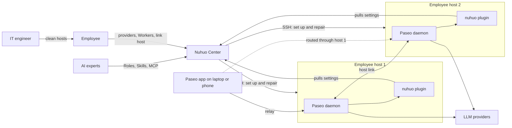

# Nuhuo enterprise plugin design

Status: proposed, version 5, 19 November 2026. The code in [`nuhuo-plugin/`](../nuhuo-plugin/)
implements version 3 (one host per employee, a bundle pushed to the host); [§7](#7-plugin-phase-1)
lists what changes. Phase 2 is not started.

Source baseline: Paseo `02124454b`; Nuhuo `5ac4631`. Proposed types and APIs below are contracts
unless this doc names the file that implements them.

## 1. Outcome

IT hands each employee one or more clean hosts and configures nothing for them. The employee adds
their Nuhuo SSH public key to a host and links it in Nuhuo, which installs Paseo and the Nuhuo plugin.
From then on the employee configures everything in Nuhuo:

- Providers, each with the employee's own API key.
- Workers, each picking one of their hosts, a Role, one of their providers, a model, a mode, a
  thinking level, and a working directory.

The plugin on each host imports all of it, so every agent is ready to use in Paseo. The employee
chats from the Paseo app on their laptop, phone, or browser, and the agents keep running while the
laptop is closed. A Worker agent can start any of the employee's other Workers as a subagent on that
Worker's host. AI experts maintain the Roles, Skills, and MCP server templates Workers use.

The Paseo app on the employee's laptop also runs a local daemon, where the employee sets up their own
agents and providers. That daemon is out of scope: the plugin never runs there.

| Decision                                                                                                      | Source                                                 |
| ------------------------------------------------------------------------------------------------------------- | ------------------------------------------------------ |
| IT hands out clean hosts and configures nothing per employee; an employee can have many; a host has one owner | User, 19 Nov 2026                                      |
| The employee links a host to Nuhuo with an SSH public key; Nuhuo sets the host up                             | User, 19 Nov 2026                                      |
| Employees create providers with their own API keys in Nuhuo; agents are ready to use in Paseo                 | User, 19 Nov 2026                                      |
| Employees create their own Workers in Nuhuo                                                                   | User, 19 Nov 2026                                      |
| The plugin imports the employee's settings from Nuhuo; the employee chats in Paseo                            | User, 19 Nov 2026                                      |
| Workers run as subagents of other Workers, across the employee's hosts                                        | User, 19 Nov 2026                                      |
| Employees enroll their devices through a link; company SSO comes later                                        | User, 19 Nov 2026                                      |
| Phase 1 uses only today's plugin API; core changes are phase 2                                                | User, 19 Nov 2026                                      |
| Nuhuo keeps one SSH key pair per employee; the private key never leaves Nuhuo                                 | Proposal; see [§5.2](#52-link-a-host)                  |
| Nuhuo uses SSH only to set up and repair a host; all settings arrive through the plugin's pull                | Proposal; see [§4](#4-topology)                        |
| The plugin runs on every employee host and nowhere else                                                       | Proposal; see [§4](#4-topology)                        |
| Each host links to the employee's other hosts, so one enrollment shows all of them                            | Proposal; see [§5.5](#55-enroll)                       |
| Create and open decide from the host's cached catalog, so a Nuhuo outage stops no running work                | Proposal; see [§6.2](#62-catalog)                      |
| Agents follow their Worker's current release on every open                                                    | Proposal; see [§6.6](#66-releases-and-existing-agents) |

Version 3 gave each employee one host prepared by Nuhuo and pushed a bundle to it. Version 4 had IT
configure hosts and gateway credentials. Both are replaced. The Nuhuo half lives in
[Nuhuo's integration design](../../nuhuo/docs/paseo-integration-design.md); its release, variant, and
mode-ID rules still apply, and its import model predates this version.

## 2. What Paseo provides today

| Fact                                                                                        | Source                                                          | Consequence                                                                                           |
| ------------------------------------------------------------------------------------------- | --------------------------------------------------------------- | ----------------------------------------------------------------------------------------------------- |
| Every authenticated client is admitted as `owner` with all permissions                      | `packages/server/src/server/session-admission-auth.ts:18`       | The employee can change providers, edit plugin settings, and disable or remove plugins on their hosts |
| Only Hub relationships carry narrower grants                                                | `packages/server/src/server/hub/relationship-controller.ts`     | Principals and pairing invitations in [permissions](permissions.md) are a model, not code             |
| Agents and terminals run code as the daemon's OS user                                       | [permissions](permissions.md#permissions)                       | Anyone who can chat can read what that user can read, including plugin files and credentials          |
| A relay pairing offer is a reusable bearer credential                                       | [security](../public-docs/security.md)                          | Phase 1 has no per-device revocation                                                                  |
| `config.patch` adds and removes provider profiles, including their `env`, without a restart | `packages/server/src/server/daemon-config-store.ts:387`         | The plugin installs the employee's providers and API keys                                             |
| `agent.create.before` waits and may rewrite or reject the saved config                      | [hooks](../public-docs/plugins/hooks.md#agentcreatebefore)      | The plugin can make every new agent a Worker                                                          |
| The create hook receives `config`, `env`, and `metadata`, not labels                        | `packages/plugin/src/server/lifecycle.ts:131`                   | Native `create_agent` cannot name a Worker                                                            |
| `agent.open.before` waits on create, resume, refresh, and import                            | [hooks](../public-docs/plugins/hooks.md#agentopenbefore)        | Role, MCP, environment, and tools are re-applied on every open                                        |
| Model, mode, and thinking changes on a running agent have no waiting hook                   | [hooks](../public-docs/plugins/hooks.md#hooks)                  | The plugin cannot veto a live change to bypass mode                                                   |
| A daemon saves other hosts; its agents create and prompt agents there by `serverId`         | [connected hosts](connected-hosts.md#delegating-agents)         | Workers delegate across the employee's hosts                                                          |
| The app adds every host saved on a daemon it connects to, routed through that daemon        | `packages/app/src/runtime/host-runtime.ts:2527`                 | One enrollment shows all of an employee's hosts                                                       |
| A plugin attaches tools to agents at open; a tool runs in the plugin with a Paseo API       | [hooks](../public-docs/plugins/hooks.md#attach-tools-to-agents) | The plugin gives agents a tool that starts a Worker                                                   |
| SDK creation accepts `metadata` and a `parent` on another host                              | `packages/client/src/index.ts:268`                              | A Worker child is bound at creation and appears in its parent's Subagents track                       |
| Agent-scoped `send_agent_prompt` to another host registers a finish notification            | `packages/server/src/server/agent/tools/paseo-tools.ts:671`     | The parent learns when a Worker child finishes                                                        |
| Paseo has no command that installs the daemon as a boot service                             | [CLI reference](../public-docs/cli.md)                          | Nuhuo's setup writes the service unit itself                                                          |

## 3. Governance boundaries

Because the employee controls their hosts, put every rule that must hold outside them. The plugin
sets defaults and makes the Worker experience the normal path; it is not a security boundary.

| Control                                                             | Enforced by                                              | Holds if the employee tampers with a host |
| ------------------------------------------------------------------- | -------------------------------------------------------- | ----------------------------------------- |
| Spend and model access of an API key                                | The provider account that issued the key                 | Yes                                       |
| Network egress                                                      | IT's network policy for the host                         | Yes                                       |
| Access to a host                                                    | IT stops or wipes it                                     | Yes                                       |
| Provider kinds, Roles, and models offered in Nuhuo                  | Nuhuo's forms                                            | No                                        |
| Role, Skills, MCP, provider, model, and starting mode of each agent | Plugin hooks                                             | No                                        |
| Usage records                                                       | The provider account; the phase 1 plugin reports nothing | Yes                                       |

Never label plugin-applied settings as enforced in the UI. Show them as the Worker's configuration.

With employees' own API keys, the company sets no spend or model limit. If it needs one, issue keys
for a company gateway; employees enter those keys in Nuhuo the same way.

Nuhuo holds every employee's API keys and an SSH key that reaches all their hosts. Encrypt both at
rest. A Nuhuo compromise is a compromise of every linked host, so authenticating its service
([§10](#10-nuhuo-dependencies)) is blocking.

Linking an employee's hosts makes them one trust domain. Code running on one host can read the
pairing offers of the others and drive them as owner. Never link hosts that belong to different
employees.

## 4. Topology



The plugin runs where the agents run. Hooks apply on the daemon that owns the agent, and the hosts
stay up while the laptop sleeps. A plugin on the laptop would route the app through a daemon that
stops when the lid closes.

Nuhuo reaches a host over SSH to set it up and to repair or upgrade it. Providers, Workers, Skills,
and secrets reach the host when the plugin pulls over HTTPS, so a settings change never needs SSH.
The app reaches hosts only through the relay.

## 5. Lifecycle

### 5.1 Hand out a host

IT gives the employee a clean machine or VM with an account for them, SSH reachable from Nuhuo, and
a network policy. IT installs nothing else and records nothing about the employee on the host.

### 5.2 Link a host

The employee adds the public key from their Nuhuo profile to `~/.ssh/authorized_keys` on the host,
then links the host in Nuhuo with its address and user. Nuhuo sets it up over SSH in this order and
stops at the first failure:

1. Probe the OS and architecture with Nuhuo's existing host probe.
2. Install Node, Paseo, and the agent CLIs on Nuhuo's supported list, such as Claude Code and Codex.
3. Install a service that starts the daemon at boot and keeps it running after logout: a systemd user
   unit with lingering on Linux, a LaunchAgent on macOS. Keep the daemon on loopback; the relay is the
   only route in.
4. Run `paseo daemon pair --relay --json`. Record the offer URL and the daemon's server ID on the host
   record, and issue a host token.
5. Write the host credential ([§6.1](#61-host-credential)).
6. Install the plugin with `paseo plugin add <path>`, set `pluginsEnabled` to `true`, and run
   `paseo reload`. Installed plugins stay off until that switch is on.

Every step is idempotent: run setup again to repair or upgrade a host. Removing Nuhuo's key from
`authorized_keys` after setup keeps the host working; Nuhuo can then no longer repair it.

The plugin pulls as soon as it starts, so the host has the employee's providers within seconds.

### 5.3 Create providers

The employee creates a provider in Nuhuo: a kind from the supported list (Claude, Codex, and so on),
a label, their API key, and optionally a base URL and models. Nuhuo stores the key encrypted. Every
host of the employee installs it on its next pull as a Paseo provider profile with the key in its
`env` ([§6.7](#67-providers)). It appears in Paseo's provider list ready to use, for Worker and
ordinary agents alike.

After applying providers, each pull posts the host's inventory: the models, modes, and thinking
options each provider reports there. Pressing **Import** in Paseo right after creating a provider
makes its models available in Nuhuo's Worker form.

### 5.4 Create Workers

The employee creates a Worker in Nuhuo by choosing one of their hosts, a Role, one of their
providers, a model, a mode, a thinking level, and a working directory on that host. Nuhuo offers only
what expert policy allows and what the host's last inventory reports, so mode and thinking are Paseo
IDs from that host, as [Nuhuo §5.3](../../nuhuo/docs/paseo-integration-design.md#53-mode-and-thinking-ids)
requires. On save, Nuhuo publishes a release. Moving a Worker to another host removes it from the old
one.

### 5.5 Enroll

Nuhuo's enrollment page lists the employee's hosts, each with its offer as a link and QR code. The
employee opens one in the Paseo app on their laptop, phone, or browser, once per device. The other
hosts appear in the app routed through that host, because each host saves its peers
([§6.5](#65-peer-links)). Opening more links adds direct routes, so the app still reaches those hosts
when the first one is down.

Treat the page like a password: show it only to the signed-in employee, expire it after first view,
and log who opened it.

### 5.6 Import and chat

The plugin adds a **Nuhuo** screen to the sidebar. When several hosts carry the plugin, Paseo shows one
item with a host picker; every host shows the same list.

- **Import from Nuhuo** pulls now. Each host also pulls when the plugin starts and every 5 minutes.
- The screen lists the employee's providers, and their Workers grouped by host with each host's link
  status.
- **Chat** starts a new agent for the Worker on its host, in its working directory, and opens it.

The new-agent composer also shows a **Worker** picker with the Workers of that composer's host.
Choosing one sets the provider, model, mode, and thinking the release names. On creation the plugin
applies the release again and records the binding, so an agent created through the CLI, the SDK, or
another agent gets the same configuration.

### 5.7 Delegate

Every agent the plugin opens gets two tools:

| Tool                 | Does                                                                                      |
| -------------------- | ----------------------------------------------------------------------------------------- |
| `nuhuo_list_workers` | Lists the employee's Workers: name, description, Role, host, provider, and model          |
| `nuhuo_start_worker` | Starts an idle subagent for a Worker on its host and returns its `serverId` and `agentId` |

The parent sends the task with Paseo's `send_agent_prompt`, passing `serverId`. That call registers
the finish notification; an agent created through the SDK gets none, so the tool starts the child
idle. The child appears in the parent's Subagents track, and its host's create hook applies the
release as for any agent.

Native `create_agent` cannot name a Worker, because the create hook does not see labels. A child
created with it gets its host's default Worker or is rejected, as [§6.3](#63-applying-a-release)
describes.

### 5.8 Update and offboard

A change in Nuhuo reaches a host at its next pull. New agents use the new release at once; existing
agents pick it up on their next open ([§6.6](#66-releases-and-existing-agents)). A changed API key
applies at each agent's next launch or resume. Deleting a Worker stops its agents from opening;
deleting a provider removes its profile.

To take a host back, IT wipes it; the employee's other hosts drop the link at their next pull. To
offboard an employee, IT wipes their hosts and Nuhuo revokes their SSH key and host tokens. A new
offer requires running setup again, because phase 1 cannot revoke a paired device.

## 6. Contract with Nuhuo

### 6.1 Host credential

Setup writes `~/.nuhuo/paseo/host.json` with mode `0600`. Set `NUHUO_PASEO_HOME` in the daemon's
environment to use another directory; the plugin process inherits it.

```json
{ "centerUrl": "https://nuhuo.example.com", "hostId": "host_123", "token": "..." }
```

The token reads this host's catalog, secrets, and Skill archives, and writes its inventory, nothing
else. The employee owns the host and can read the file; it shows them nothing that is not already
theirs.

### 6.2 Catalog

The plugin calls these endpoints under `{centerUrl}/api/paseo/v1/hosts/{hostId}` with
`Authorization: Bearer <token>`:

| Endpoint               | Returns or takes                                                                |
| ---------------------- | ------------------------------------------------------------------------------- |
| `GET /catalog`         | The `HostCatalog` below                                                         |
| `GET /secrets`         | Values for every `secretRef` the catalog names for this host                    |
| `GET /assets/{digest}` | A Skill archive                                                                 |
| `PUT /inventory`       | The daemon's server ID, and each provider's models, modes, and thinking options |

It writes the catalog atomically to `catalog.json` beside the credential and decides from that file,
so a failed pull keeps the last good catalog until it expires. The catalog carries no secret values.

```ts
type HostCatalog = {
  schema: 2;
  centerId: string;
  hostId: string; // the host that pulled
  employee: { id: string; displayName: string };
  issuedAt: string;
  expiresAt?: string;
  requireWorker: boolean; // on this host
  defaultWorkerId?: string; // a Worker on this host
  providers: CatalogProvider[]; // every provider of the employee
  hosts: EmployeeHost[]; // every host of the employee, this one included
  workers: CatalogWorker[]; // every Worker of the employee, on any of their hosts
};

type CatalogProvider = {
  providerId: string; // Paseo provider ID, always starting with "nuhuo-"
  extends: string; // built-in Paseo provider: "claude", "codex", ...
  label: string;
  env: Record<string, string>; // non-secret values such as a base URL
  secretEnv: Record<string, { secretRef: string }>; // the API key
  models?: { id: string; label: string }[];
};

type EmployeeHost = {
  hostId: string;
  name: string;
  serverId: string; // Paseo server ID of the host's daemon
  connection: string; // relay pairing offer, used for peer links
};

type CatalogWorker = {
  workerId: string;
  hostId: string;
  name: string;
  description?: string;
  roleName: string;
  workDir: string; // absolute path on the Worker's host
  provider: string; // a CatalogProvider ID
  model?: string;
  modeId?: string; // Paseo mode ID
  thinkingOptionId?: string;
  release?: WorkerRelease; // only for Workers on this host
};

type WorkerRelease = {
  releaseDigest: string;
  displayVersion: string;
  allowedOverrides: ("model" | "modeId" | "thinkingOptionId")[];
  instructions: string; // ROLE.md, profile instructions, and the Skill index with host paths
  skills: { id: string; version: string; digest: string }[];
  mcpServers: Record<string, McpServerTemplate>; // secrets as { secretRef }
  env: Record<string, string>;
  secretEnv: Record<string, { secretRef: string }>;
};
```

Other hosts' Workers carry what listing and delegation need; each host applies its own releases.

A missing, invalid, or expired catalog blocks new agents and interactive opens with a message naming
the problem. History opens always proceed.

### 6.3 Applying a release

On `agent.create.before`:

| Request                                                | Result                                            |
| ------------------------------------------------------ | ------------------------------------------------- |
| `metadata["nuhuo.worker"]` names a Worker on this host | Apply that release                                |
| Names a Worker on another of the employee's hosts      | Reject, naming the Worker and its host            |
| Names a Worker not in the catalog                      | Pull once within 10 seconds, then apply or reject |
| No Worker, `defaultWorkerId` set                       | Apply the default release                         |
| No Worker, no default, `requireWorker: true`           | Reject: choose a Worker                           |
| No Worker, `requireWorker: false`                      | Leave the agent ordinary                          |

The pull on an unknown Worker lets the employee chat with a Worker minutes after creating it, without
waiting for the next poll. It stays inside the 30-second hook timeout.

Applying sets `provider` from the release. Provider changes reset the rest, so the release's model,
mode, and thinking replace the request's. On the same provider, a field listed in `allowedOverrides`
keeps the request's value and other fields take the release's. The plugin writes
`metadata["nuhuo.binding"] = { centerId, workerId, workerName, releaseDigest }` and drops any binding
the caller sent. It does not save the Role into `systemPrompt`.

On `agent.open.before` with `purpose: "interactive"`:

| Agent                                          | Result                                                                              |
| ---------------------------------------------- | ----------------------------------------------------------------------------------- |
| Bound, Worker on this host, same provider      | Append `instructions`; add `mcpServers`, `env`, resolved secrets, and the two tools |
| Bound, Worker deleted or moved to another host | Block: the Worker is no longer on this host                                         |
| Bound, release moved to another provider       | Block: start a new agent for this Worker                                            |
| Unbound, `requireWorker: true`                 | Block: covers imports and agents created before the plugin                          |
| Unbound, `requireWorker: false`                | Add the two tools                                                                   |

### 6.4 Secrets and Skills

After each catalog pull, the plugin fetches `/secrets` and writes each value to a file in the
`secrets/` directory beside the credential, with mode `0600` in a `0700` directory. It removes files
the catalog no longer names. Worker secrets are read at open time, so they never enter an agent's
saved configuration or the catalog. A name containing a path separator or a missing file blocks the
open.

For each Skill a release lists, the plugin downloads the archive once, checks it against `digest`,
and unpacks it to `skills/<id>/<version>/`. It refuses archives with absolute paths, `..`, links that
leave the directory, or device files. A failed download blocks opens of that Worker until a pull
succeeds.

### 6.5 Peer links

After each pull, the plugin reconciles the daemon's saved hosts with the catalog's `hosts` through
`context.paseo.hosts`:

- Add each other host with its offer, its name as label, and source key `nuhuo:<hostId>`. Repeating an
  unchanged add returns the saved entry.
- Update the connection when an offer changes. A host set up again from scratch has a new server ID;
  remove its registration and add it again rather than replacing the identity.
- Remove registrations with a `nuhuo:` source key that the catalog no longer lists.
- Leave registrations the employee added, and keep a link the employee disabled.

### 6.6 Releases and existing agents

Launch-only contributions are re-derived on every open, so an existing agent follows its Worker's
current release: a fixed Role or Skill reaches every employee without restarting conversations. The
saved provider, model, mode, and thinking stay as created. The binding's `releaseDigest` records what
the agent was created with, for audit. Pinning each agent to its creation release needs the
immutable binding of phase 2.

### 6.7 Providers

After each pull, the plugin makes the daemon's `nuhuo-` provider profiles match the catalog with one
`context.paseo.config.patch` call. `providers` sets `extends`, `label`, `models`, and `env` with the
API key resolved from `secrets/`; `removeProviders` drops `nuhuo-` profiles the catalog no longer
lists. The plugin patches only when something changed, then posts the inventory. It never touches
profiles without the prefix, so the employee's own providers on the host stay as they are.

Paseo stores the keys in `config.json` in plain text. Every agent on the host can read them, as it
can read any key in its environment.

## 7. Plugin (phase 1)

Package: `nuhuo-plugin/` at the repository root, manifest ID `nuhuo`. It runs on employee hosts only.
Keep it out of `plugins/`: built-ins load for every Paseo user, everything in that directory ships in
the desktop build, and built-in IDs cannot be installed by path. It is not an npm workspace, so root
`npm run typecheck` skips it; run `npm install --legacy-peer-deps`, `npm run typecheck`, and
`npm test` inside it.

The plugin requires the first Paseo release after 0.16.2. `appendSystemPrompt` on
`agent.open.before` landed in paseo#9781 and is in no 0.16.x release, so the manifest declares
`>=0.17.0-0`. Correct the range if that change ships under another version.

| File                        | Responsibility                                                    | Change from version 3 code           |
| --------------------------- | ----------------------------------------------------------------- | ------------------------------------ |
| `shared/catalog.ts`         | Zod schemas for the credential, catalog, and binding              | Replaces `shared/bundle.ts`          |
| `shared/rpc.ts`             | `nuhuo.status.get`, `nuhuo.catalog.import`, `nuhuo.workers.start` | Add the last two                     |
| `server/catalog-store.ts`   | Read, validate, and cache the catalog                             | Replaces `server/bundle-store.ts`    |
| `server/nuhuo-client.ts`    | Call the endpoints in [§6.2](#62-catalog), with timeouts          | New                                  |
| `server/sync.ts`            | One pull: catalog, secrets, Skills, providers, peers, inventory   | New                                  |
| `server/providers.ts`       | Reconcile `nuhuo-` provider profiles ([§6.7](#67-providers))      | New                                  |
| `server/skills.ts`          | Download, verify, and unpack Skill archives                       | New                                  |
| `server/peer-links.ts`      | Reconcile saved hosts ([§6.5](#65-peer-links))                    | New                                  |
| `server/worker-tools.ts`    | `nuhuo_list_workers` and `nuhuo_start_worker`                     | New                                  |
| `server/policy.ts`          | Decision tables in [§6.3](#63-applying-a-release)                 | Add host checks and the pull on miss |
| `server/secrets.ts`         | Write and resolve secret files                                    | Add writing                          |
| `client/workers-screen.tsx` | Nuhuo screen: import, providers, Workers by host, Chat            | Replaces `client/status-screen.tsx`  |
| `client/worker-picker.tsx`  | Composer item: Worker `Select` for this host                      | Filter to this host's Workers        |

One pull runs at a time; an Import during a pull waits for it. **Chat** calls `nuhuo.workers.start` on
the selected host. For a Worker on another host, the handler creates the agent through
`context.paseo.hosts.client(serverId)`. The screen then opens it with
`navigation.openAgent({ agentId, serverId })`. `nuhuo_start_worker` creates the same way and passes
the calling agent as `parent`.

The composer item reads Workers through `nuhuo.status.get`. In a draft it sets
`metadata["nuhuo.worker"]` and then the release's provider, model, mode, and thinking, so the composer
shows what will run. On a running agent it shows the bound Worker and is disabled. The create hook
remains the authority.

Errors name the Worker and the fix, for example **Worker "Code reviewer" is no longer on this host.
Start a new agent with another Worker.** Raw schema and network errors go to the plugin log; secret
values never do.

## 8. Phase 1 limits

- The employee is `owner` of each host. They can disable the plugin, edit its files, or change an
  agent's metadata. [§3](#3-governance-boundaries) lists what still holds.
- A running agent's model, mode, and thinking can change without a check.
- Withdrawal reaches a running agent at its next open; turns on an open agent continue.
- A paired device cannot be revoked without running setup again.
- A host learns of a change at its next pull: plugin start, every 5 minutes, Import, or an unknown
  Worker at creation.
- The app reaches routed hosts only while the host it enrolled through is online.
- Native `create_agent` cannot name a Worker; agents delegate with `nuhuo_start_worker`.
- API keys sit in Paseo's `config.json` in plain text ([§6.7](#67-providers)).

## 9. Phase 2: core changes

| Item                                 | Change                                                                                                                                                                     | Unlocks                                                                                     |
| ------------------------------------ | -------------------------------------------------------------------------------------------------------------------------------------------------------------------------- | ------------------------------------------------------------------------------------------- |
| C1 Principals and invitations        | Implement the [permissions](permissions.md) model for direct and relay clients: single-use pairing invitations that create a principal with chosen grants, plus revocation | Employee devices get `workspace.*` only; Nuhuo keeps `daemon.manage`; per-device revocation |
| C2 Runtime-change and turn admission | Awaited plugin callbacks before model/mode/thinking/option changes and before each turn                                                                                    | Policy holds for live changes and withdrawal stops the next turn                            |
| C3 Launch binding                    | Store the Worker binding outside metadata; only the creation path writes it; resume requires the binding's source                                                          | Pinned releases; metadata cannot forge or remove a binding                                  |
| C4 Worker-aware creation             | Pass labels to `agent.create.before`, or let `create_agent` carry plugin metadata                                                                                          | Native `create_agent` starts a Worker in one step; `nuhuo_start_worker` retires             |
| C5 Provider secrets                  | Provider `env` values that reference a secret file instead of plain text in `config.json`                                                                                  | API keys kept out of the daemon config                                                      |
| C6 Shared hosts                      | Workspace-scoped grants with resource checks on every operation, and per-user OS isolation for agents and terminals                                                        | Several employees on one daemon                                                             |

C1 alone does not make governance hold: a `workspace.write` principal can still run code as the
daemon user through an agent. Pair it with an agent runtime that cannot read daemon state, such as a
separate OS user for agent processes.

Follow [protocol compatibility](protocol-compatibility.md) and [RPC namespacing](rpc-namespacing.md):
advertise each item under `server_info.features`, add dotted `.request`/`.response` RPCs, and keep new
fields optional. The plugin checks the features once and keeps phase 1 behavior on older hosts.

## 10. Nuhuo dependencies

| Item                                                                                                                                                               | Status                                                                                 |
| ------------------------------------------------------------------------------------------------------------------------------------------------------------------ | -------------------------------------------------------------------------------------- |
| Authenticate the service before exposing it beyond loopback ([Nuhuo §3](../../nuhuo/docs/paseo-integration-design.md#3-prerequisite-authenticate-the-service-n00)) | Blocking: Nuhuo holds API keys and SSH access, and hosts call it over the network      |
| Accounts for experts and employees, with employee sign-in                                                                                                          | New                                                                                    |
| One SSH key pair per employee, shown as a public key on their profile                                                                                              | New                                                                                    |
| Linking a host and running setup over SSH ([§5.2](#52-link-a-host))                                                                                                | Extends the host probe and `HostEntry`, which already has SSH fields and `pairingLink` |
| Employee providers with encrypted API keys                                                                                                                         | New                                                                                    |
| Worker form limited by expert policy and the host's inventory                                                                                                      | Extends `WorkerMetadata` (`hostId`, `agent`, `model`, `mode`, `thinking`, `workDir`)   |
| Host API ([§6.2](#62-catalog)) and Skill archives addressed by digest                                                                                              | New                                                                                    |
| Releases with a verified `paseo` variant                                                                                                                           | Specified in Nuhuo §5                                                                  |
| Enrollment page listing the employee's hosts                                                                                                                       | New                                                                                    |

## 11. Verification

| Case                              | Expected                                                                                           |
| --------------------------------- | -------------------------------------------------------------------------------------------------- |
| Link a clean host                 | Daemon running as a boot service with the plugin enabled; running setup again changes nothing      |
| Provider created or deleted       | `nuhuo-` profile added with its key or removed; other profiles untouched; inventory posted         |
| Create with a Worker on this host | Saved provider/model/mode/thinking match the release; binding metadata written                     |
| Create with another host's Worker | Rejected, naming the Worker and its host                                                           |
| Create with an unknown Worker     | One pull; applied if the new catalog has it, rejected otherwise                                    |
| Create without a Worker           | Default applied, rejected, or ordinary according to [§6.3](#63-applying-a-release)                 |
| Overrides                         | Allowed field keeps the caller's value; other fields take the release's                            |
| Open                              | Role appended, MCP, env, and tools added, secrets resolved from files and absent from saved config |
| Skills                            | Archive digest checked, unsafe archives refused, files under `skills/<id>/<version>/`              |
| Worker deleted or moved           | Interactive open blocked with the Worker named; history open works                                 |
| Catalog missing, invalid, expired | New agents and interactive opens blocked; a failed pull keeps the last good catalog                |
| Peer links                        | Added, updated, and removed to match the catalog; employee-added and disabled links untouched      |
| Enroll through one host           | The employee's other hosts appear in the app as routed hosts                                       |
| Chat                              | Agent created on the Worker's host in its working directory and opened                             |
| Delegate                          | Child in the parent's Subagents track; finish notification after `send_agent_prompt`               |
| Picker                            | Draft, New workspace, and running-agent composers on iOS, Android, browser, and Electron           |

`nuhuo-plugin/server/policy.test.ts` covers the version 3 decision tables, bundle states, and secret
files. Hook wiring, provider profiles, peer links, delegation, and the screens need an
[ad-hoc daemon](ad-hoc-daemon-testing.md) run with two daemons on a build that includes paseo#9781.
